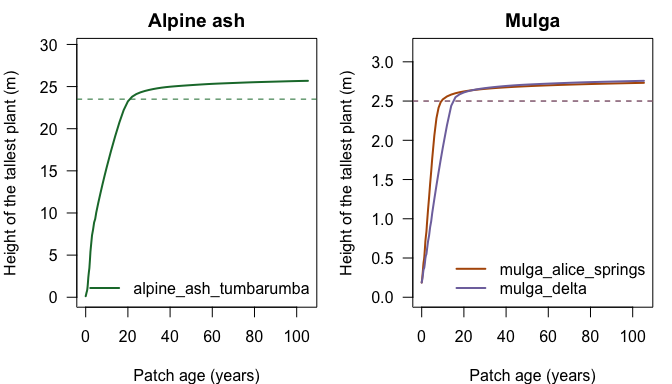

<!--
sets.Rmd is generated from sets.Rmd.orig: each set downloads WorldClim and runs
a full patch, too slow to build with the package. Regenerate against the plant
pinned in DESCRIPTION, from inside vignettes/ (knitr writes the figure and its
cache relative to the working directory), with

  knitr::knit("sets.Rmd.orig", output = "sets.Rmd")

The runs are cached in vignettes/cache/ (not committed) and rerun when a set
file, fieldtrial's version or the installed plant library changes.
-->


A parameter set is one species at one site: its traits, the trade-offs that derive its other parameters from them, the parameters set directly, the soil, the climate and the run's settings, each value with the source it came from. This vignette loads each set the package ships, runs it through plant, and compares how the stands grow.


``` r
library(fieldtrial)
list_sets()
#> [1] "alpine_ash_tumbarumba" "mulga_alice_springs"   "mulga_delta"
```

## What a set holds

A set is a YAML file in `inst/sets/`. `parameter_set()` reads it and builds the four inputs `plant::run()` takes: a `Parameters` object with one strategy, the `Environment` with the set's soil and climate, a `Control`, and the rainfall events.


``` r
mulga <- parameter_set("mulga_alice_springs")
mulga
#> <fieldtrial_set> mulga_alice_springs: TF24 at Alice Springs Mulga (AU-ASM)
#>   built against TF24@v15; 5 trait(s), 3 direct par(s); drivers from worldclim
names(mulga)
#> [1] "p"         "env"       "ctrl"      "events"    "tradeoffs" "met"       "meta"
```

Every number in the file names its source, and the parsed file stays on the set as `meta`. For example, the mulga's wood density and its height at maturation:


``` r
mulga$meta$traits$rho
#> $value
#> [1] 950
#> 
#> $source
#> [1] "Santini-2016 (doi:10.1007/s00468-015-1301-5), Table 1: A. aneura branch wood density 0.95 +/- 0.07 g cm-3, Ti Tree Basin, n = 6"
mulga$meta$pars$hmat
#> $value
#> [1] 2.5
#> 
#> $source
#> [1] "Preece-1971a (doi:10.1071/bt9710021), Methods: the flowering mulga studied were mostly between 2 and 3 m tall (chosen as a size convenient for counting flowers); a proxy for height at maturation, which has no direct measurement. AusTraits' mean plant height (4.7 m) was tried first: the stand reached it only in the 105th year, so it barely reproduced"
```

Some values are proxies, marked as such in their source: no stem vulnerability curve exists for any mulga taxon, so the mulga sets use the leaf water potential at stomatal closure for stem and root P50. The built strategy holds all three kinds of value: the traits (here `lma`, `rho`, `vcmax_25`), the parameters set directly (`root_P50`, `hmat`), and the parameters the trade-offs derive from the traits (here `stem_P50`, through a coefficient the set overrides):


``` r
mulga$p$strategies[[1]]$pars[c("lma", "rho", "vcmax_25", "root_P50", "hmat", "stem_P50")]
#> $lma
#> [1] 0.4579142
#> 
#> $rho
#> [1] 950
#> 
#> $vcmax_25
#> [1] 174
#> 
#> $root_P50
#> [1] 6.7
#> 
#> $hmat
#> [1] 2.5
#> 
#> $stem_P50
#> [1] 6.7
```

The first set to load downloads WorldClim's 10 arc-minute grids, about 200 MB, into `tools::R_user_dir("fieldtrial", "cache")`, and later loads reuse them. The climate is WorldClim's 1970–2000 mean year, repeated for the length of the run.

`check_set()`, which `parameter_set()` runs by default, refuses a set built against a different plant model version from the one installed, since the same numbers can mean a different plant after a scientific change:


``` r
mulga$meta$plant_scientific_version
#> [1] "TF24@v15"
plant::model_id("TF24")
#> [1] "TF24@v15"
```

## Running the sets

`run_set()` hands the four inputs to `plant::run()`. Asking it to record the steps lets `plant::tidy()` turn the run into tables. Each run is a single patch of plant's default length, 105 years; on a laptop the alpine ash takes about a quarter of an hour, the Alice Springs mulga eight minutes and the Delta mulga under a minute. The function below keeps what this vignette plots from each run: the height of the tallest plant at each step, the set's height at maturation, and its offspring production.


``` r
summarise_set <- function(name) {
  res <- run_set(name, record = "steps")
  sp <- plant::tidy(res)$species
  sp <- sp[is.finite(sp$height), ]
  h <- tapply(sp$height, sp$time, max)
  list(tallest = data.frame(set = name, time = as.numeric(names(h)),
                            height = as.numeric(h)),
       hmat = res$scenario$p$strategies[[1]]$pars[["hmat"]],
       offspring_production = res$offspring_production)
}
runs <- lapply(setNames(nm = list_sets()), summarise_set)
tallest <- do.call(rbind, lapply(runs, `[[`, "tallest"))
hmat <- sapply(runs, `[[`, "hmat")
```


``` r
cols <- c(alpine_ash_tumbarumba = "#1b7837", mulga_alice_springs = "#b35806",
          mulga_delta = "#8073ac")
panel <- function(sets, main) {
  d <- tallest[tallest$set %in% sets, ]
  plot(NA, xlim = range(d$time), ylim = c(0, 1.15 * max(d$height, hmat[sets])),
       xlab = "Patch age (years)", ylab = "Height of the tallest plant (m)",
       main = main, las = 1)
  for (name in sets) {
    abline(h = hmat[[name]], col = cols[[name]], lty = 2)
    with(d[d$set == name, ], lines(time, height, col = cols[[name]], lwd = 2))
  }
  legend("bottomright", legend = sets, col = cols[sets], lwd = 2, bty = "n")
}
op <- par(mfrow = c(1, 2), mar = c(4, 4, 2, 1))
panel("alpine_ash_tumbarumba", "Alpine ash")
panel(c("mulga_alice_springs", "mulga_delta"), "Mulga")
```

<div class="figure">

<p class="caption">The tallest plant in each stand through time. Dashed: the set's height at maturation (hmat).</p>
</div>

``` r
par(op)
```

Offspring production: the seed produced over a lifetime per seed arriving, averaged over patches of every age (plant's `fitness_weighting`) and multiplied by the birth rate, which is 1 in every set:


``` r
sapply(runs, `[[`, "offspring_production")
#> alpine_ash_tumbarumba   mulga_alice_springs           mulga_delta 
#>            1523.96497              42.76542             278.68797
```

## What the runs show


Each stand grows quickly until its tallest plants reach their height at maturation, and then nearly stops. By 105 years the alpine ash stands at 25.7 m, against a height at maturation of 23.5 m, and the two mulga stands at 2.73 and 2.76 m, against 2.5 m. These are not the heights of the trees at these sites: the alpine ash canopy at Tumbarumba is about 40 m, and AusTraits' mean height for *Acacia aneura* is 4.7 m (both cited in the set files).

The ceiling comes from how TF24 divides surplus production between growth and reproduction. The share going to reproduction rises with height `h` as `a_f1 / (1 + exp(a_f2 * (1 - h / hmat)))`, and none of the sets change plant's defaults for its two coefficients:


``` r
mulga$p$strategies[[1]]$pars[c("a_f1", "a_f2")]
#> $a_f1
#> [1] 1
#> 
#> $a_f2
#> [1] 50
```

With `a_f1 = 1` the share approaches all of the surplus, and with `a_f2 = 50` it gets there quickly: 99% of the surplus goes to reproduction once a plant is 1.092 times its height at maturation, which is 25.7 m for the alpine ash and 2.73 m for the mulga. Growth does not stop there, but it slows to a crawl: the stands keep creeping upwards, and the Delta mulga has passed that height by 105 years.

So in these sets `hmat` is close to the height the stand reaches, not only the height at which it starts to reproduce. That is why the alpine ash set's `hmat` was derived from a run without maturation (the height reached at 20 years, its juvenile period) rather than taken from the size at which saplings first flower, which would cap the forest at about 6 m. Letting trees keep growing after they mature would take an `a_f1` below 1, which leaves a share `1 - a_f1` of the surplus for growth at any height; a smaller `a_f2` only moves the point where growth fades further above `hmat`. A set can give either under `pars:`, with a source for the value.
